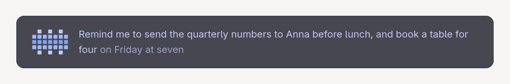
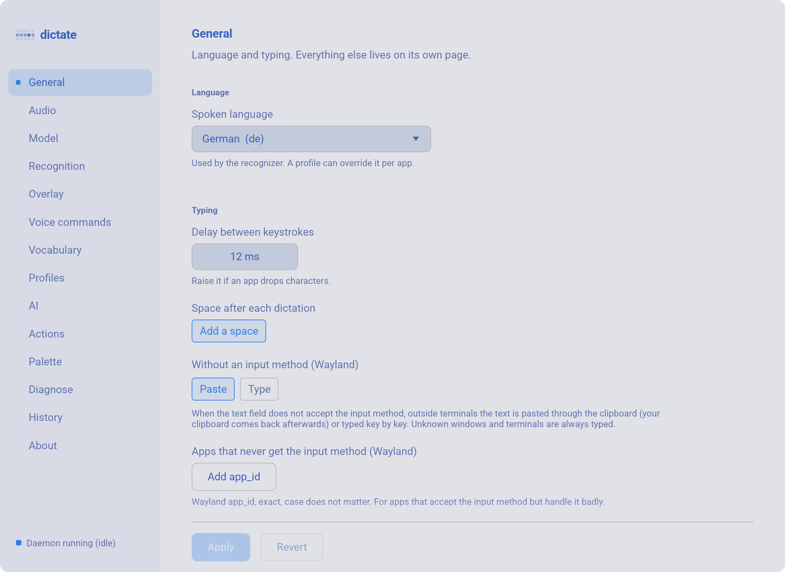
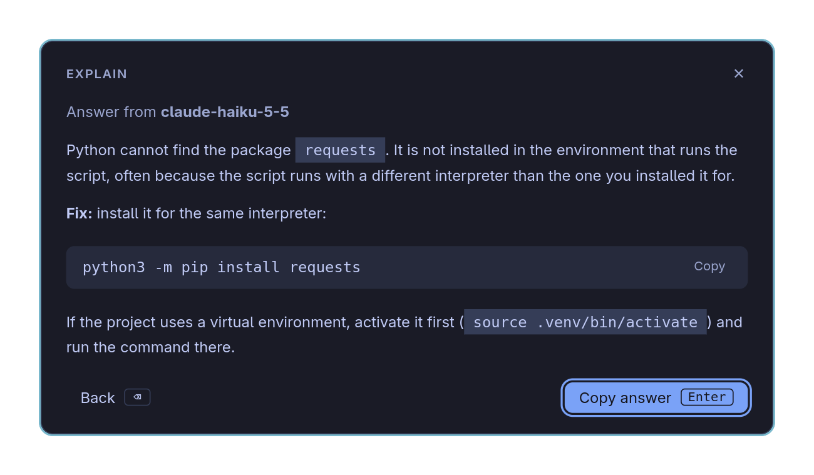
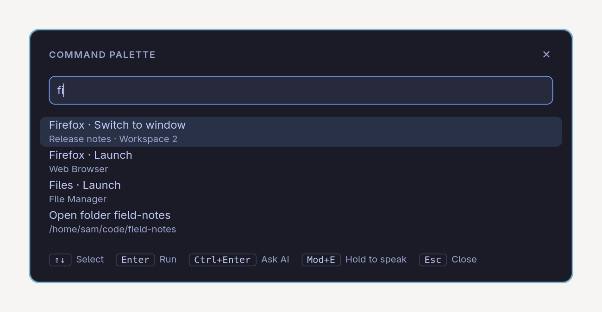
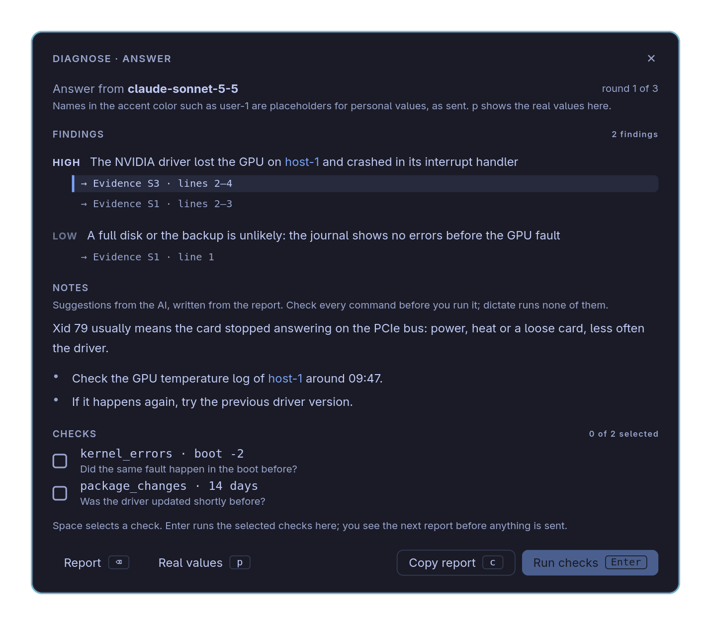

<div align="center">

<a href="https://pushingpixels.at">
  <picture>
    <source media="(prefers-color-scheme: dark)" srcset="docs/assets/logo-dark.svg">
    <source media="(prefers-color-scheme: light)" srcset="docs/assets/logo-light.svg">
    
  </picture>
</a>

<h1>dictate</h1>

<p><strong>Live, local dictation for Wayland: hold a key, speak, and the text lands in the focused field.</strong></p>

<p>
  <a href="https://github.com/derblub/dictate/actions/workflows/ci.yml"></a>
  <a href="LICENSE"></a>
</p>

<p>
  <a href="#features">Features</a> ·
  <a href="#privacy-and-security">Privacy</a> ·
  <a href="#requirements">Requirements</a> ·
  <a href="#installation">Installation</a> ·
  <a href="#usage">Usage</a> ·
  <a href="#configuration">Configuration</a> ·
  <a href="CHANGELOG.md">Changelog</a>
</p>

</div>

---

An overlay shows your words while you talk, and when you let go of the key, the final text in Whisper quality lands
reliably in the focused field. Speech recognition runs entirely on your own GPU, and no audio ever leaves the machine.
On top of dictation, dictate brings text actions on the selection, a command palette and a read-only Linux diagnosis,
each optional.

<p align="center">
  
</p>

dictate currently targets the [niri](https://github.com/niri-wm/niri) compositor and NVIDIA GPUs (CUDA). Other
compositors and a non-NVIDIA backend are not supported yet.

## Features

- **Live transcript while you speak.** The current phrase is re-decoded about every 250 ms; confirmed words are shown
  bright, the uncertain tail dimmed. The final pass starts shortly after you stop speaking, so the text is usually
  there 30 to 200 ms after you release the key (measured on an RTX 3060, see [Performance](#performance)).
- **Whisper quality, without hallucinations in pauses.** whisper.cpp (`large-v3-turbo`, quantized) with Silero VAD;
  quiet microphones are boosted before detection.
- **Lands in the field.** Text goes through the field's input method where possible, otherwise it is pasted (your
  clipboard is restored afterwards) or typed through a virtual keyboard. Terminals are never pasted into, and
  clipboard contents marked as secret by a password manager are never read.
- **Hold to speak or hands-free.** Hold `Mod+E`, or toggle hands-free mode with `Mod+Shift+E`.
- **Optional AI post-processing** with your own API key: clean-up, e-mail, translation, turning a spoken request into
  a structured prompt. Anthropic, OpenAI-compatible servers (OpenAI, Mistral, OpenRouter, …) and local servers
  (Ollama, LM Studio) are supported. Off by default; the default server is a local Ollama, so nothing leaves the
  machine unless you choose a cloud provider.
- **[Text actions](#text-actions-on-the-selection)** (`Mod+I`, off by default): explain, analyze an error, explain
  code, translate, rephrase or refine a prompt on the current selection, with a preview of what is sent before any
  cloud request.
- **[Command palette](#command-palette)** (`Mod+Alt+Space`): focus windows, switch workspaces, start programs, open
  projects, control media and volume, take screenshots; type or speak. Matching is local; the AI is asked only on
  request and can only pick from a fixed catalog of intents, never run free text.
- **[Linux diagnosis](#linux-diagnosis)** (`Mod+Shift+I`, off by default): collects read-only information (last boot,
  failed units, Docker, network, heat) from a fixed catalog, redacts secrets, pseudonymizes users, hosts and
  addresses, shows you the exact report, and only then lets an AI suggest causes and further read-only checks.
- **Settings window** (`dictate-settings`) for everything, including model downloads.

<p align="center">
  <picture>
    <source media="(prefers-color-scheme: dark)" srcset="docs/assets/settings-dark.png">
    
  </picture>
</p>

### Accessibility

The hands-free mode lets you dictate without holding a key, which can help if typing is painful or tiring. dictate is
a dictation tool, though, not a replacement for full voice control of the desktop.

## Privacy and security

- Speech recognition is local. The microphone is open only while dictate is listening.
- The default AI server is a local Ollama; a cloud provider is used only if you choose one, with your own key.
  Dictation post-processing (`features.ai`), text actions and the diagnosis are off by default; the command palette is
  on, and asks the configured model only on request.
- Text actions, palette input and the diagnosis report pass a secrets filter before a cloud request (private keys, API
  keys and tokens of known providers, JWTs, `Authorization` headers, passwords in URLs and assignments, random-looking
  tokens, possible passwords and passphrases). Text actions, the palette's clipboard explanation and the diagnosis show
  a preview of exactly what will be sent. Dictated text sent for AI post-processing is not filtered, since you spoke
  it yourself.
- AI answers are never executed. The palette starts programs only as argument lists resolved to an absolute path;
  diagnosis probes come only from a fixed catalog; nothing runs through a shell or with `sudo`. Every prompt for
  dictation modes and text actions starts with a fixed guard (the input is text to work on, never an instruction);
  the palette's `?question` has a fixed frame of its own for answering.
- Selections, clipboard contents, palette input, diagnosis reports and AI answers never appear in a log, not even with
  `DICTATE_DEBUG`, and never in the history. Dictated text appears in the log only with `DICTATE_DEBUG=1`, and in the
  optional history (`features.history`, off by default: `~/.local/state/dictate/history.jsonl`, 0600) only if you turn
  it on.
- Locking the screen closes open panels, aborts a running output and discards selection and diagnosis data held in
  memory.

## Requirements

- Linux with the [niri](https://github.com/niri-wm/niri) Wayland compositor
- An NVIDIA GPU with the CUDA toolkit (dictate is built against CUDA; it does not ship any NVIDIA libraries)
- PipeWire (with its PulseAudio interface) or PulseAudio
- GTK 4 and gtk4-layer-shell
- Read access to `/dev/input/event*` (group `input`): dictate only queries which keys are held (`EVIOCGKEY`) to detect
  the release of the speak key; it never reads key presses
- Rust; the exact toolchain is pinned in `rust-toolchain.toml` and installed by rustup automatically (the AUR package
  builds with Arch's current Rust instead)

Optional: the Noctalia shell for matching colors (see [Colors](#colors)); without it dictate uses a Tokyo Night dark
palette. The command palette locks the screen through logind, so locking needs a screen locker that follows logind
(such as Noctalia with its lock screen turned on, swayidle with swaylock, or hypridle). Its clipboard history and emoji picker use Noctalia and rofi
with the rofi-emoji plugin unless you set other programs (`clipboard_command`, `emoji_command`); each is offered only
if its program is installed.

## Installation

dictate is built from source, either through the AUR package or with cargo.

### Arch Linux (AUR)

```bash
paru -S dictate   # or another AUR helper, or makepkg -si in a clone of the AUR repository
systemctl --user enable --now dictate.service dictate-ui.service
```

Then add `include "/usr/share/dictate/dictate-binds.kdl"` to `~/.config/niri/config.kdl`. The package updates this file
together with the binaries, so shortcuts, window rules and `dictate-ui` always match; do not include a copied
`dictate-binds.kdl` as well. Download the speech models in the settings window (page "Model"). The Noctalia template
is at `/usr/share/dictate/dictate.json.tmpl` (see [Colors](#colors)).

The package builds the release tag with Arch's current Rust and takes CUDA from the packages `cuda` and
`nvidia-utils`; it contains no NVIDIA files. whisper.cpp is compiled for the GPU architectures it picks by default
(Turing, RTX 20xx, and newer; cards without prebuilt code compile it once on the first start), so the build needs
no GPU. To build only for your card, which is faster, set the architecture before building, for example
`CMAKE_CUDA_ARCHITECTURES=86` for an RTX 30xx. The PKGBUILD lives in [`packaging/aur/`](packaging/aur/).

### From source

```bash
cargo install --path . --locked   # installs dictate, dictate-ui and dictate-settings to ~/.cargo/bin

cp systemd/dictate.service systemd/dictate-ui.service ~/.config/systemd/user/
systemctl --user enable --now dictate.service dictate-ui.service

cp niri/dictate-binds.kdl ~/.config/niri/
# then add to ~/.config/niri/config.kdl:  include "dictate-binds.kdl"
```

The first CUDA build takes several minutes. It compiles whisper.cpp for the GPU in the machine that builds it (CMake
finds `nvcc` through `PATH` or `CUDA_PATH`). To build for other cards, for example on a machine without a GPU, set
the compute capabilities in the environment, such as `CMAKE_CUDA_ARCHITECTURES=86` for an RTX 30xx; `CUDACXX` names
a different `nvcc`. Cargo does not notice a later change to these variables: run `cargo clean -p whisper-rs-sys`
before building again.

Download the speech models in the settings window (page "Model"), or place them under
`~/.local/share/dictate/models/` yourself: `ggml-large-v3-turbo-q5_0.bin` from
[ggerganov/whisper.cpp](https://huggingface.co/ggerganov/whisper.cpp) and `ggml-silero-v5.1.2.bin` from
[ggml-org/whisper-vad](https://huggingface.co/ggml-org/whisper-vad).

`dictate-binds.kdl` and `dictate-ui` belong together: install a new version of one only together with the matching
version of the other. An older `dictate-ui` does not know newer commands, and a `dictate-ui` with the command palette
needs the window rule "dictate: leaving" from the matching file (without it, niri fills the invisible panel with the
focus ring color in screenshots taken from the palette). The rule for the rounded corners of `dictate-settings` and
the binary belong together in the same way.

`dictate-ui.service` starts only in a Wayland session (`niri-session` imports `WAYLAND_DISPLAY` into the user
manager) and connects to the daemon through its socket.

### Colors

dictate takes its colors from a palette file that Noctalia writes from the template `noctalia/dictate.json.tmpl`
(register it in `~/.config/noctalia/config.toml` under `[theme.templates.user.dictate]`); Noctalia writes it to
`~/.local/state/dictate/palette.json`. `dictate-ui` and `dictate-settings` watch the file and recolor immediately when
the scheme or the light/dark mode changes. If the file is missing, unreadable or lacks one of the ten roles read, Tokyo
Night dark applies. The settings window uses the font from `gtk-font-name` in `~/.config/gtk-4.0/settings.ini`, like
GTK applications; it ships no fonts of its own.

## Usage

| Shortcut | Action |
|---|---|
| hold `Mod+E` | speak; releasing writes the text |
| `Mod+Shift+E` | hands-free on/off |
| `Mod+Ctrl+E` | cancel; nothing is written, a running output (dictation, replace) stops |
| `Mod+Ctrl+Shift+E` | settings window (floating) |
| `Mod+I` | text actions on the selection (pressing it again closes the panel) |
| `Mod+Shift+I` | Linux diagnosis (pressing it again closes the panel) |
| `Mod+Alt+Space` | command palette (pressing it again closes the panel) |

Only one panel is open at a time: the shortcut of another panel closes the open one.

Command line: `dictate-ui hold|toggle|cancel|actions|diagnose|palette` (the shortcuts call exactly these; `cancel` also
works without a running `dictate-ui` and goes straight to the daemon), `dictate daemon` (the service) and
`dictate transcribe FILE.wav [--stream]` to test the model on a 16 kHz mono file (`--stream` adds latency statistics).

### Output

`typing.output` (default `paste`) decides how text reaches the field: first through the field's input method
(`zwp_input_method_v2`, held only for the duration of one output), otherwise outside terminals through the clipboard
(save, offer, Ctrl+V, restore; if the clipboard carries `x-kde-passwordManagerHint: secret`, the text is typed
instead), otherwise through dictate's own virtual keyboard. Terminals (`actions.terminal_classes`) are never pasted
into, because pasted multi-line text could run commands; line breaks go there as Return, elsewhere as Shift+Return
(chat fields where Enter sends). `type` always types; `typing.keyboard_only_app_ids` lists programs that never get the
input method.

### AI post-processing

Optional. Built-in modes: `clean`, `email`, `to_en`, `to_de` and `prompt`. `prompt` turns a dictated request to an AI
assistant into a structured one (goal, context, requirements, output format, open points; same language as the input,
nothing invented, never executed; only "goal" is mandatory, the other sections appear only with content from the
text). Only `email` and `prompt` may produce line breaks. `prompt` aims at two to three times the length of the input;
an answer longer than twice that counts as executed rather than rewritten, and the raw text is used instead. `prompt`
gets at least 20 s instead of `ai.timeout_ms`.

- `ai.endpoint` empty means the preset's base URL; a configured endpoint is never replaced. With an API key, only
  `https://` (or loopback) is accepted, and no credentials in the URL.
- `ai.model` empty means the provider's default and follows a change of preset: Anthropic `claude-haiku-5-5`, Ollama
  `qwen2.5:7b-instruct`. OpenAI-compatible presets have none; there a model is required as soon as AI or text actions
  are on. On saving, every model must fit the server (the Anthropic API only `claude-…`, other cloud presets no
  `claude-…`); for custom servers the window only warns.
- Model per mode in `[ai.mode_models]`, form of address in translations into German with `ai.formality` (`auto` from
  the tone of the source, `informal`, `formal`).
- "Undo" works only in the same application and within 30 s. `cancel` also aborts a running AI request immediately.
- The configuration file stores only deviations from the built-in modes and action prompts: `[ai.modes]` changes or
  adds single modes, `ai.removed_modes = ["email"]` removes built-in ones, `[actions.prompts]` changes single actions.
  Everything else takes the current default, so improved prompts reach you.

## Text actions on the selection

Off by default; turn on under Settings › Actions (`features.actions = true`). Select text, then press `Mod+I`. The
panel (`dictate-panel`, a floating window that takes the focus) shows length and source, the target ("Sends to
<host> when you pick an action" for a cloud server, otherwise "Runs on <host>"), the first lines and the actions in
two groups: **Answer in this panel** (`e` Explain, `a` Analyze error, `c` Explain code) and **Replace the selection**
(`t` Translate DE ↔ EN, `r` Rephrase, `p` Refine prompt, plus the AI modes on `1` to `9` with `include_ai_modes`).

<p align="center">
  
</p>

Mouse and keyboard are equivalent: hover and `↑`/`↓`/`Tab` highlight the same row, `Enter` or a click (on release)
triggers it, as does the action's key. After every change of the panel, keys and clicks do nothing for 300 ms, and a
key already held triggers only after release, so a double `r` never replaces unread. Answers stream in as readable
Markdown (paragraphs, lists, code, code blocks with their own "Copy"; links are not clickable). In the result:

- `Enter` is the primary button: **Replace** for replacing actions (pastes over the selection, only in the same window,
  never in terminals), otherwise **Copy answer**. `c` always copies, `BackSpace` goes back to the action list for the
  same selection; mouse wheel, scroll bar and `↑`/`↓`/`PgUp`/`PgDn`/`Space`/`Home`/`End` scroll.
- Replacing actions show the changes marked (deleted struck through, new highlighted), except Translate and Refine
  prompt; `d` or "Show clean text" toggles. After Replace, the clipboard is what it was before.
- The overlay confirms ("Copied 342 characters") and shows the progress of a replace; `Mod+Ctrl+E` stops it.
- Errors offer "Try again" (`Enter`) and Back; "Nothing selected" is a neutral hint.

`Esc`, the ✕, a focus change or a second `Mod+I` close the panel and clear the selection in the daemon; while an action
runs, `Esc` stops it. If the selection contains a secret and the server is in the cloud, the panel shows what was
found instead of the actions.

- Only the **PRIMARY** selection is read, never the clipboard.
- With `actions.secrets = "local_only"` (default) a detected secret blocks every cloud request (a local server stays
  allowed), with `"block"` every request; blocked text is not even stored.
- Before a cloud request the panel shows host, model, character count and the beginning of the text; only picking an
  action sends it.
- The selection is cleared after 300 s without a key press, when the session ends and when the screen locks.
- The log records only action, character count, duration and the kinds of secrets found.

## Command palette

One input field for everything, on by default (Settings › Palette, `palette.enabled`). `Mod+Alt+Space` opens the panel
(the same floating window as text actions and diagnosis); the window that had the focus before is remembered. Type or
speak, and the list shows what matches right away: focus windows (niri follows to their workspace), switch workspaces
(also to the previous one), move windows to a workspace, toggle floating, fullscreen and maximized, column as tabs or
normal, start programs, open projects (a terminal in the project folder, optionally running a command such as
Claude Code, see `terminal` and `project_command` below), folders and addresses, web
search (`g word`), volume, media, screenshots (screen, window, area), lock, clipboard history and emoji picker (each
only if its program is installed, see `clipboard_command` and `emoji_command` below), settings pages, diagnosis, and
text and AI. Logout, reboot, power off, suspend and closing a window
need a second confirmation (a second `Enter` or the "Confirm" button).

<p align="center">
  
</p>

**Two stages.** Locally, on every key press and without a model: fuzzy search (word starts, umlauts ignored), keywords
in German and English, frequency as a bonus. The AI only on request: `Enter` asks the model if the list has no
confident match and you have not moved the selection yourself, `Ctrl+Enter` always asks. The model never returns
executable text, only an intent from a fixed catalog (such as `focus_window` with a search term). The search term is
resolved locally against real windows, workspaces, programs and projects; if nothing matches, there is no match. The
result is shown as a preview ("→ …") and runs only on `Enter`.

**Running.** niri actions go through niri's IPC, always with the fixed ID from the candidate, never "the focused
window"; if the window is gone, the panel says "That window is gone". Programs are started only as argument lists via
niri (`Spawn`), resolved against the search path to an absolute path, never through a shell. Short helpers (`pactl`,
`playerctl`, `systemctl`, `loginctl`, `noctalia msg …`) run directly with a 10 s limit; their error message appears in
the overlay. Lock runs `loginctl lock-session`, which asks logind to lock your graphical session; your screen locker
does the locking, and if none listens to logind, nothing happens. The clipboard history and the emoji picker start
`clipboard_command` and `emoji_command` like a program; left empty, the clipboard history opens Noctalia's clipboard
panel and the emoji picker runs `rofi -modi emoji -show emoji`. The palette looks for these programs in the search path
of your session (checked again at most every 2 seconds) and leaves out what it does not find; if the AI picks one that
is missing, the panel says so. For screen and area screenshots the panel first becomes invisible, then niri takes the
shot, then the panel closes.

| In the panel | Effect |
|---|---|
| `↑`/`↓`, `Tab`/`Shift+Tab` | move the selection (`↑` in the first row recalls earlier inputs, 50, kept in memory only) |
| `Enter` / `Ctrl+Enter` | run or ask the AI / always ask the AI |
| hold `Mod+E` | speak; the text replaces the input line, `Enter` runs it (never automatically). `Mod+Shift+E` hands-free, `Mod+Ctrl+E` cancel |
| `Esc`, ✕ | cancel a confirmation, recording or AI request, otherwise close |
| `Mod+Alt+Space`, `Mod+I`, `Mod+Shift+I` | close the palette (the shortcut of another panel only closes, it opens nothing) |

Text and AI: `?question` (intent `ask`) streams the answer into the text actions panel. "Explain clipboard" reads the
clipboard, shows length, target and beginning, and sends only after `Enter`. A text action opens the text actions panel
on the selection with the action preselected and also sends only after `Enter`.

Privacy:

- Only the input and the catalog of intents go to the model, never window titles or the names of programs and
  projects. Every input passes the secrets filter before a cloud request; a hit blocks the cloud.
- The clipboard is read only for "Explain clipboard", with the same limits, filter and preview as the selection; if it
  carries a password manager's hint, only the hint is read.
- Input (typed or spoken), context, candidates, targets, answers and search terms never appear in a log.
- Frequency is stored in `~/.local/state/dictate/frecency.json` (0600): only the identifier of the target (program,
  project path, intent) with a counter and time, never input text. It can be turned off and cleared in the settings.
- While the screen is locked, `Mod+Alt+Space` is refused with a hint in the overlay.

## Linux diagnosis

Off by default; turn on under Settings › Diagnose (`diagnose.enabled = true`). The diagnosis collects **read-only**
information about the system, shows the report before sending and lets an AI suggest causes and read-only checks. It
is meant for questions like: what happened at the end of the last boot (freeze, oops, kernel messages, temperature
log)? Plus failed units, Docker containers, network and heat. `Mod+Shift+I` opens the panel; the command palette knows
the intent `diagnose` ("why did it crash", "diagnose docker", "diagnose unit cups") and opens the panel with the
profile preselected.

**A catalog instead of commands.** Neither the model nor you type a command. A *probe* is a fixed entry in the catalog
(33 probes: boot, units, Docker, network, resources, heat) with an argument template, typed parameters, a size limit
and a deadline; collecting and the checks the AI proposes use the same catalog. Names of units, containers and boots
are resolved locally against the real lists (the model's text is never used as an argument). Probes run as argument
lists, never through a shell, never with `sudo`, with an emptied environment, `nice 10` and idle I/O priority, one
after another, within a total budget of 15 s. There are no changing actions (restart, package, downgrade); suggestions
of that kind appear only as text in the AI's notes.

| Profile | Contents |
|---|---|
| Last crash | what the previous boot left behind: end of its journal, kernel errors, pstore, temperature log, package changes, driver and kernel version |
| Now | failed units, kernel warnings, memory, load, disks, sensors, GPU |
| Unit | status and journal of one unit (chosen from the failed units) |
| Docker | containers and the journal of containers that are not running or restarting; `docker system df` is in the profile but deselected (it makes `dockerd` work unthrottled) |
| Network | interfaces, DNS, listening sockets, Tailscale, network mounts |
| Heat | sensors, GPU, NVMe, temperature log, load, top processes |

The flow: **choose → preview → send → checks**.

<p align="center">
  
</p>

| In the panel | Effect |
|---|---|
| `1` to `6` or `↑`/`↓` + `Enter` | choose a profile (for "Unit", then the unit); `Space` toggles entries, `Enter` collects (`Esc` aborts and keeps nothing) |
| preview: `↑`/`↓`, `Space` | choose a section (`S1`, `S2` …) and take it out of the report or back in |
| preview: `Tab` or click into "What is wrong?" | describe briefly what is wrong (optional, up to 300 characters) |
| `Enter` | send exactly this preview to the AI; `Esc` closes without sending anything |
| `c` or "Copy report" | copy the report (redacted, pseudonymized) to the clipboard; nothing is sent |
| answer: `↑`/`↓`, `Space`, `Enter` | choose evidence or a check; `Enter` on evidence jumps to its lines in the preview, `Space` selects a check, `Enter` runs the selected ones |
| `p` or "Real values" | replace placeholders in the answer with the real values, `p` again goes back |
| `⌫` | back (answer ↔ preview) |
| `Esc`, ✕, `Mod+Shift+I` | close; the daemon discards the session |

- **Preview:** the text of the preview is byte for byte the text that is sent. Redactions and placeholders are
  highlighted; the header names target host and model. If the AI server changes between preview and sending, nothing
  is sent. The report is at most `report_kib` (default 48 KiB); journals are shortened from the front, repeated lines
  summarized.
- **Answer:** *findings* (cause, confidence, evidence as section and lines of the report), *checks* (at most five probes
  from the catalog with a reason, **all deselected**) and *notes*. dictate discards evidence pointing nowhere, invented
  probes and parameters, foreign ping targets and more than five checks.
- **Checks** run only after `Space` and `Enter`, never automatically. Their results pass the same redaction and preview
  and go to the next round only after `Enter`; at most `rounds` answers (default 3). The ping probe is in no profile and
  pings only targets from `ping_targets`.
- **Hint after an unclean shutdown:** if the previous boot did not end cleanly, `dictate-ui` shows "Last boot ended
  uncleanly · Mod+Shift+I to diagnose" in the overlay once per boot, for 20 s; a click opens the diagnosis. Nothing is
  collected or sent for that. Off: `diagnose.boot_hint = false`.
- **Model:** with a Claude server Sonnet 5.5 by default, otherwise the model from `[ai]`.
- **pstore:** `systemd-pstore` stores its files under `/var/lib/systemd/pstore/` as `root` with mode `0600`. Without
  access, dictate sees only time, number and size of the files, not their content (such as an oops). dictate does not
  change this and never calls `sudo`; to let it read the content, grant your user read access yourself (for example an
  ACL via `tmpfiles.d` plus a drop-in for `systemd-pstore.service` that sets it after archiving).

Privacy:

- Only the text of the preview goes to the AI, together with the fixed prompt, the catalog, the profile name and the
  **names** of the ping targets (not their addresses). Local models get the same text.
- **Redact instead of block:** matches of the secrets filter are replaced by `[REDACTED:<kind>]` for every target, local
  ones included. Process command lines appear only as program names, `docker inspect` never with `Env` or `Labels`. If
  anything remains before sending, sending is blocked.
- **Pseudonyms** (`diagnose.pseudonymize`, on by default): users, host names, IP and MAC addresses, SSIDs, e-mail
  addresses, the machine ID and personal paths under `/home` are replaced per session by placeholders (`user-1`,
  `host-2`, `ip-3` …); equal values get equal placeholders. The mapping lives only in memory.
- **Nothing stored:** report, probe output and answers live only in the daemon's memory (a session lasts at most 30
  minutes; closing the panel and locking the screen delete it) and never appear in a log. The only file of the
  diagnosis is `~/.local/state/dictate/diagnose.json` (0600) with the identifier of the last boot checked for the hint.
- **Docker** is accessed only through the local socket, with an empty Docker configuration of its own and only with
  reading commands.

## Configuration

Settings live in `~/.config/dictate/config.toml` and are easiest to change in the settings window, which writes only
values that differ from the defaults. Every key is optional, unknown keys are an error; the full list with defaults is
in `src/config.rs`. The most important ones: `language` (`de`), `source` (Pulse source, empty = default),
`max_gain_db` (default 30, 0 to 40, 0 = off), `commit_silence_ms` (700), `idle_unload_s` (600), `max_listen_s` (120,
0 = unlimited), `initial_prompt` (terms as a hint for Whisper), `blocklist`, `trailing_space`.

**Quiet microphones:** Silero VAD depends on the level and recognizes speech around −40 dBFS only in fragments. dictate
therefore raises the speech level of each recording to about −20 dBFS before VAD and Whisper, by at most
`max_gain_db` (Settings › Audio › "Boost quiet input up to"). Loud audio is never lowered, pure noise never raised;
the system volume of the microphone stays untouched. Details and measurements in `src/gain.rs`.

Text actions, `[actions]`:

| Key | Default | Meaning |
|---|---|---|
| `model` | empty | model for actions; empty = `ai.model` (or the provider's default) |
| `timeout_ms` | 30000 | deadline for the whole answer, 1000 to 120000 |
| `max_chars` | 8000 | longer selections are refused, 100 to 30000 |
| `secrets` | `"local_only"` | on detected secrets: `local_only` (cloud blocked, local allowed) or `block` |
| `language` | empty | answer language of explanations; empty = `language`, `auto` = language of the text |
| `include_ai_modes` | `true` | offer `[ai.modes]` as actions `1` to `9` |
| `terminal_classes` | Alacritty, kitty, XTerm, URxvt, st-256color, org.wezfurlong.wezterm, foot, footclient, com.mitchellh.ghostty, org.gnome.Console, org.gnome.Ptyxis, org.gnome.Terminal, org.kde.konsole | `app_id` of terminals: never replace, never paste, line break as Return |
| `[actions.prompts]` | built-in prompts | own prompt per action (`explain`, `translate`, `rephrase`, `refine_prompt`, `analyze_error`, `explain_code`) |

Command palette, `[palette]`:

| Key | Default | Meaning |
|---|---|---|
| `enabled` | `true` | off = all palette commands answer "The command palette is off" |
| `project_roots` | `["~"]` | folders under which Git repositories count as projects (absolute or with `~`), at most 32 |
| `project_depth` | 2 | search depth below a root, 1 to 4 |
| `frecency` | `true` | count chosen targets (`frecency.json`, never input text) |
| `web_search_url` | `https://duckduckgo.com/?q={query}` | search engine for `g word`: https, exactly one `{query}`, not in the host |
| `model` | empty | model for intents, `ask` and "Explain clipboard"; empty = `ai.model` (or the provider's default, Haiku 5.5 for Claude) |
| `timeout_ms` | 8000 | deadline for the intent from the model, 1000 to 60000 |
| `terminal` | empty | terminal for projects and for apps with `Terminal=true`: the program, then its arguments up to the command, such as `["alacritty", "-e"]`, `["kitty"]` or `["wezterm", "start", "--"]`; empty = the first installed of `xdg-terminal-exec`, alacritty, kitty, foot, ghostty, wezterm, konsole, gnome-terminal, xterm |
| `project_command` | empty | what opening a project runs in the terminal, in the project folder, such as `["claude"]`; empty = your shell (`$SHELL`) |
| `clipboard_command` | empty | clipboard history: the program, then its arguments, such as `["copyq", "toggle"]`; empty = Noctalia's clipboard panel (`noctalia msg panel-toggle clipboard`); offered only if the program is found |
| `emoji_command` | empty | emoji picker: the program, then its arguments, such as `["bemoji"]`; empty = rofi with the rofi-emoji plugin (looked for in `ROFI_PLUGIN_PATH` of the dictate service and under rofi's install prefix, such as `/usr/lib/rofi`; if your rofi finds its plugins elsewhere, set the command); offered only if the program is found |

Linux diagnosis, `[diagnose]`:

| Key | Default | Meaning |
|---|---|---|
| `enabled` | `false` | off = nothing is collected, the palette does not offer the intent |
| `model` | empty | model for the report; empty = `claude-sonnet-5-5` with a Claude server, otherwise `ai.model` |
| `timeout_ms` | 90000 | deadline for one round with the model, 5000 to 300000 |
| `report_kib` | 48 | size of the report in KiB, 8 to 192 |
| `rounds` | 3 | answers of the model per session, 1 to 5 |
| `temp_log_dir` | empty | folder with the CSV files of a temperature logger (absolute or with `~/`, no `..`); empty = none |
| `[[diagnose.ping_targets]]` | empty | targets for the ping probe, each with `name` and `address`, at most 16; only the name goes to the AI |
| `pseudonymize` | `true` | replace users, hosts, addresses, SSIDs and paths with placeholders |
| `boot_hint` | `true` | allow the hint after an unclean end of the previous boot |

dictate does not ship a temperature logger. Any logger works that writes one file per day, `temps-YYYY-MM-DD.csv`,
with an optional header line starting with `time,` (or `zeit,`) and one row per sample whose first column is the
local time to the second, without fraction or offset (`2026-11-04 09:47:12`, a `T` instead of the space is fine);
rows in another format are skipped, the other columns are passed on as they are. Without
`temp_log_dir`, the temperature log in the profiles "Last crash" and "Heat" reports that none is set up.

Overlay, `[overlay]`: `position` (`bottom` or `top`), `bottom_margin` (48), `max_width` (720), `transparency` (`true`:
background with `opacity`, default 0.8; `false`: opaque).

Logs: `journalctl --user -u dictate -u dictate-ui`. Transcripts appear there only with `DICTATE_DEBUG=1`.

## Architecture

- `dictate daemon` (user service) keeps Whisper `large-v3-turbo-q5_0` and Silero VAD loaded, opens the microphone only
  while listening and streams events over `$XDG_RUNTIME_DIR/dictate/control.sock`. It has no connection to the
  display. Streaming re-decodes the current phrase about every 250 ms (small `audio_ctx`, greedy) and confirms words
  with LocalAgreement-2; at pauses the phrase is committed, and the final pass starts 150 ms after speech ends.
- `dictate-ui` (user service, Wayland session only; GTK 4 and gtk4-layer-shell, links neither Whisper nor CUDA) draws
  the overlay as a layer surface without focus that lets clicks through, detects holding the key from the keyboards'
  key state, writes the text and hosts the panels for text actions, diagnosis and the command palette.
- `dictate-settings` is the settings window (egui); it also talks to the daemon only through the socket.

## Performance

Measured on an RTX 3060: interim text p95 ≈ 400 ms; final text 30 to 200 ms after release (after a short pause), 370 to
470 ms when releasing immediately. VRAM ≈ 1.2 to 2.2 GB while loaded; after `idle_unload_s` (10 min) the model is unloaded,
leaving about 120 MB of CUDA context and about 0.2 % CPU from the CUDA driver thread.

## Development

```bash
scripts/check.sh --list           # check steps, cheapest first: fmt licenses clippy unit wayland gui speech gpu
scripts/check.sh --only fmt,clippy,unit
cargo test --release              # mock tests without a GPU
cargo test --release -- --ignored # with the real model or a Pulse source
```

The `wayland` and `gui` steps run `dictate-ui` and the settings window in a nested niri against a mock daemon, never
in your session. `speech` and `gpu` need the real models, a GPU and test recordings that are not in the repository.
Logs, runtime folders and test audio live in `DICTATE_TEST_ROOT` (default `~/.cache/dictate-test`); details in
`CONTRIBUTING.md`. The CI on GitHub runs `fmt`, `licenses`, `clippy` and `unit` in an Arch Linux container without a
GPU (`.github/workflows/ci.yml`, packages in `scripts/ci-setup-arch.sh`).

Internal notes, plans and code comments are in German; user-facing texts and this README are in English.

## Contributing

Bug reports and ideas are welcome in the [issue tracker](https://github.com/derblub/dictate/issues). Code
contributions need a contributor license agreement ([CLA.md](CLA.md)); how to agree, how to run the checks and the
rules for changes are in [CONTRIBUTING.md](CONTRIBUTING.md). Everyone taking part follows the
[Code of Conduct](CODE_OF_CONDUCT.md). Security issues go through [SECURITY.md](SECURITY.md).

## License

[GPL-3.0-or-later](LICENSE) © Daniel Kurdoghlian, Pushing Pixels

The license covers the whole repository including the dictate logo (`assets/logo/`), with four exceptions: third-party
material under its own license (the EFF wordlist below), the contributor license agreement `CLA.md`, which is adapted
from the Harmony contributor agreement template and therefore licensed under CC BY 3.0 Unported, the packaging files
for the AUR in `packaging/aur/`, licensed under 0BSD like Arch Linux package sources, and the Pushing Pixels
mark and wordmark, wherever they appear in the repository (`docs/assets/logo*.svg`, `docs/assets/pushing-pixels*.svg`
and the social preview image `docs/assets/social-preview.png`), which are the author's trademarks, not licensed under
the GPL, all rights reserved. Every `.rs` file carries the license header, every shell and Python script a short header
with `SPDX-License-Identifier: GPL-3.0-or-later`; the test `tests/license_headers.rs` checks both.

**Additional permission for NVIDIA CUDA** (GPLv3 section 7, following the FSF's model text): the daemon links the
libraries of the NVIDIA CUDA Toolkit (libcudart and libcublas, which in turn loads libcublasLt; NVIDIA CUDA Toolkit End
User License Agreement) and the CUDA library of the NVIDIA driver (libcuda; NVIDIA Driver License Agreement). Anyone
linking dictate or a work based on it with these libraries may convey the result; the exact wording is in the header
of every source file. dictate does not ship CUDA; it comes from the system.

The secrets filter contains the EFF Large Wordlist for Passphrases (`assets/wordlists/eff_large_wordlist.txt`,
Electronic Frontier Foundation, https://www.eff.org/dice, unmodified), used under the Creative Commons Attribution 4.0
International license (CC BY 4.0, https://creativecommons.org/licenses/by/4.0/); source, checksum and license note in
`assets/wordlists/README.md`.

**Third-party notices:** `THIRD-PARTY-LICENSES.txt` lists everything foreign compiled into the three binaries (all Rust
crates, the Rust standard library, whisper.cpp and ggml, the EFF wordlist) with all license texts and copyright
notices that redistribution requires; `licenses/` holds the notices of the standard library and upstream license
files for crates that ship none (origin in `licenses/upstream/SOURCES.md`). The file is generated by
`scripts/third-party-licenses.py`; the check step `licenses` verifies it and, with `cargo deny`, the allow list in
`deny.toml`. Libraries that come from the system at run time (GTK 4, PulseAudio, CUDA and others) are not shipped.

---

<div align="center">
  <a href="https://pushingpixels.at">
    <picture>
      <source media="(prefers-color-scheme: dark)" srcset="docs/assets/pushing-pixels-dark.svg">
      <source media="(prefers-color-scheme: light)" srcset="docs/assets/pushing-pixels-light.svg">
      
    </picture>
  </a>
  <p>Built and maintained by <a href="https://pushingpixels.at">Daniel Kurdoghlian</a> at <a href="https://pushingpixels.at">Pushing Pixels</a> in Vienna.<br>
  Wondering whether AI pays off for a task in your business? I test it on your own examples in a one-week <a href="https://pushingpixels.at/creates/ki-beratung">AI feasibility check</a>.</p>
</div>
