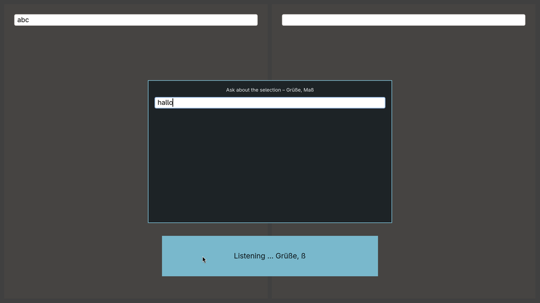
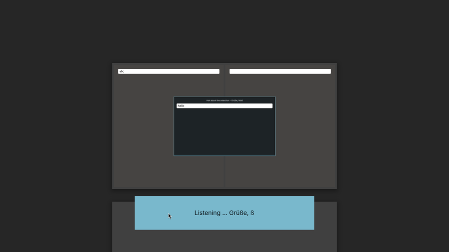
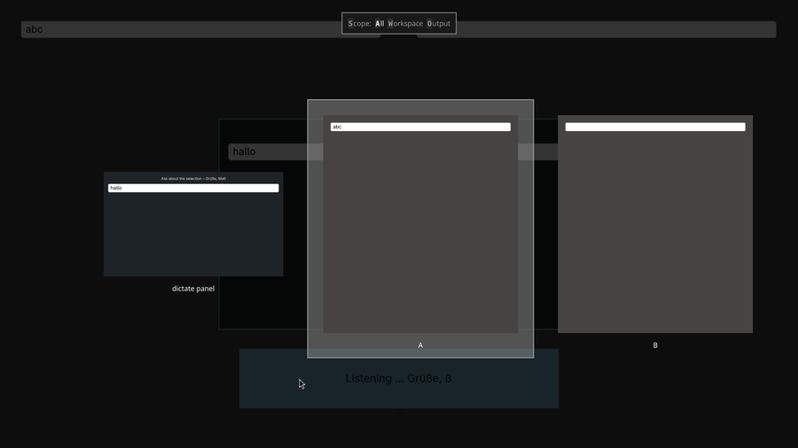
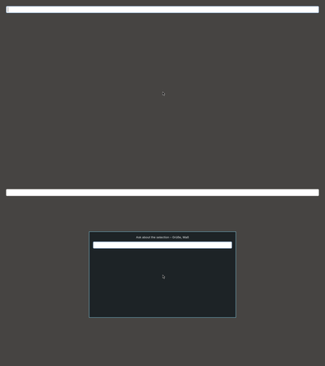
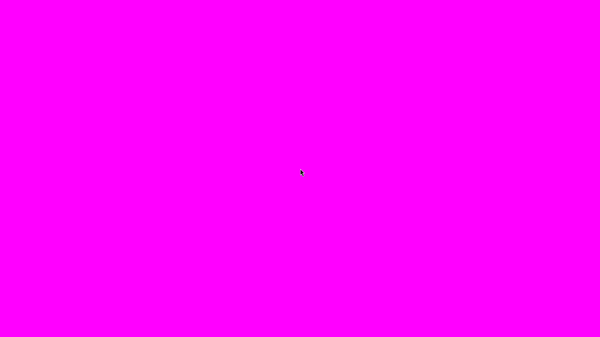

# Spike S4: GTK-Oberfläche unter niri (Overlay als Layer-Fläche, Panel als schwebendes Fenster)

Stand 20.11.2026, Block W0. Budget 2 h, gebraucht etwa 15 min (10:09 bis Commit 10:22; Nachtrag `s4b.sh` im selben Zeitraum). Kennzeichnung: **gemessen** (im
verschachtelten niri), **abgeleitet**, **offen**.

## Aufbau

- **Verschachteltes niri 26.04** im kopflosen sway 1.12 (`WLR_BACKENDS=headless`, `WLR_RENDERER=pixman`), Harness
  `tests/wayland/nested/harness.sh` (Muster niri-coach `tests/nested/harness.sh`): eigener Laufzeitordner unter
  `/home/data/stt-test/wl-run/n.XXXXXX`, `DISPLAY`/`WAYLAND_DISPLAY`/`NIRI_SOCKET`/`SWAYSOCK`/Session-Bus entfernt,
  `nmsg` verweigert jeden Socket außerhalb, Abbau nur über eigene PIDs/Prozessgruppen (jeder Lauf endete mit „no
  process left“). Ausgabe `winit` mit **Skalierung 1,625** (Teil A 2600×1462 → 1600×900 logisch; erste Runde 5120×2160
  → 3150×1329 logisch wie DP-4). Belegung `de nodeadkeys`, Mod = Alt (verschachtelt).
- **Probe** `spikes/wayland-gtk` (gtk4-rs 0.11.5, gtk4-layer-shell 0.8.1 gegen System-GTK 4.24.1 und
  gtk4-layer-shell 1.3.0; `libgtk4-layer-shell.so` steht im ELF vor GTK, Ladereihenfolge passt):
  `overlay` (Layer `Overlay`, Namensraum `dictate-overlay`, `KeyboardMode::None`, nach jedem Map **leere
  Eingaberegion**), `panel` (langlebiger Prozess ohne Fenster; `show` legt ein `xdg_toplevel` mit app_id
  `dictate-panel` und Eingabefeld an, `hide` = unmap, `close` = zerstören), `target` (Zielfenster mit Eingabefeld).
- **Physische Eingaben** über ein virtuelles Gerät auf dem kopflosen sway (`tests/wayland/nested`, Kopie des
  niri-coach-Injektors); niri sieht sie wie eine echte Tastatur. Bewertung auf Wire-Ebene (`WAYLAND_DEBUG=client`) und
  über `niri msg -j` gegen den verschachtelten Socket.
- Skripte: `spikes/wayland-gtk/s4.sh` (Teile A–C), `spikes/wayland-gtk/s4b.sh` (Vollbild, Resize). Logs und Bilder:
  `/home/data/stt-test/logs/wl-spikes/s4/run2`, `…/s4b/run1`. Zwei Läufe von `s4.sh` mit gleichen Ergebnissen (der
  erste hatte zu kurze feste Wartezeiten bei A16/A17 und eine falsche Pixelzählung, beides verworfen und ersetzt).

Fensterregel im Test (Vorlage für `dictate-binds.kdl`/Installation):

```kdl
window-rule {
    match app-id="^dictate-panel$"
    open-floating true
    open-focused true          // nötig, siehe Vollbild
    default-column-width { fixed 720; }
    default-window-height { fixed 420; }
}
```

## Ergebnisse

### Overlay (Layer-Fläche)

| Frage | Ergebnis | Art |
|---|---|---|
| Nimmt das Overlay den Fokus? | **nein**: `niri msg -j layers` → `dictate-overlay`, `Overlay`, `keyboard_interactivity: None`; fokussiertes Fenster vor und nach dem Map gleich (A), keine `focus in` am Overlay | gemessen |
| Klick-durch mit leerer Eingaberegion | **ja**: Klick mitten ins Overlay landet im Fenster darunter (A +1 Klick), das Overlay bekommt nicht einmal `wl_pointer.enter` | gemessen |
| Tippen bei sichtbarem Overlay | geht ins Zielfenster (`abc` in A), Overlay sieht keine Taste | gemessen |
| Skalierung 1,625 | GTK nutzt `wp_fractional_scale_v1` (`preferred_scale(195)` = 1,625 × 120), `gdk::Surface::scale()` = 1,625; Puffer **1040×195** für 640×120 logisch über `wp_viewport.set_destination(640, 120)`, also pixelgenau, nicht hochskaliert | gemessen |
| Über Vollbildfenstern | sichtbar (Layer `Overlay`) | gemessen (Bild) |
| Übersicht | bleibt oben und unverkleinert sichtbar | gemessen (Bild) |
| Fensterwechsel (Alt+Tab, MRU) | liegt **unter** der abgedunkelten MRU-Ansicht | gemessen (Bild) |
| niri-Shader beim Erscheinen | **keine**: mit Test-Shader „alles magenta“ für `window-open` 0 magentafarbene Pixel beim Map des Overlays (nach 0,3 s und 1,8 s), Overlay selbst sichtbar | gemessen |



### Panel (schwebendes GTK-Fenster)

| Frage | Ergebnis | Art |
|---|---|---|
| Schwebend über Fensterregel | ja (`is_floating: true`, 720×420) | gemessen |
| Fokus beim Erscheinen (langlebiger Prozess, `show` auf Befehl, ohne von außen durchgereichtes Token) | **ja**, auch beim Wiederzeigen nach `hide` (5 von 5). GTK holt sich dafür bei `present()` **selbst** ein Token (`xdg_activation_v1.get_activation_token` mit der letzten Seat-Serial, auch 0) und ruft `activate` für die eigene Fläche; niri gewährt das. `dictate-ui` muss also kein Token durchreichen. Ob niri ein neues Fenster auch ganz ohne `activate` fokussiert, wurde nicht geprüft | gemessen |
| Tippen ins Panel | geht (`hallo` im Eingabefeld) | gemessen |
| Fokus nach dem Schließen (`close`, zerstört) | **zurück zum vorher fokussierten Fenster A**, obwohl B das neueste Fenster ist | gemessen |
| Fokus nach dem Ausblenden (`hide`, unmap) | zurück zu A | gemessen |
| A → Panel → B fokussiert → Panel → schließen | Fokus geht an **B** (das zuletzt fokussierte), nicht an A | gemessen |
| **Panel über Vollbildfenster** | ohne Regel: Panel **unsichtbar hinter dem Vollbildfenster und ohne Fokus**, getippter Text landet im Vollbildfenster. Mit `open-focused true`: sichtbar darüber, fokussiert, Text im Panel; nach dem Schließen Fokus zurück, Vollbild bleibt | gemessen |
| niri-Shader `window-open` / `window-close` | **greifen**: Test-Shader färben die Fläche um das Panel (niri zeichnet den Shader über eine vergrößerte Fläche, daher prüfen Daniels Shader selbst die Ränder) | gemessen |
| niri-Shader `window-resize` | greift, wenn **niri** die Größe setzt (`set-window-height`), **nicht**, wenn das Fenster selbst wächst (GTK-Inhalt größer, 720×420 → 736×618 ohne Shader) | gemessen |
| Daniels `animations.kdl` (Kopie, nur gelesen) | lädt im verschachtelten niri ohne Shader-Warnung in `niri.log` | gemessen (Kompilieren auf llvmpipe, nicht NVIDIA) |
| Übersicht | Panel erscheint als schwebendes Fenster der Arbeitsfläche | gemessen (Bild) |
| Fensterwechsel (Alt+Tab, MRU, Ansicht „Scope: All“) | Panel erscheint als eigener Eintrag „dictate panel“ | gemessen (Bild) |
| Fensterregel zum Ausblenden aus Übersicht/MRU | **gibt es nicht**: `niri validate` lehnt `exclude-from-recent-windows`, `skip-taskbar`, `hide-in-overview` ab; `open-floating`, `open-focused`, `block-out-from`, `default-floating-position` sind gültig | gemessen (Kandidaten geprüft, keine Liste aller Regeln) |

 

Panel über Vollbild, oben ohne, unten mit `open-focused true`: 

Test-Shader `window-open` auf dem Panel: 

### Variante C aus 3.2 (Overlay greift beim Kürzel die Tastatur)

Kürzel `Mod+E` (verschachtelt Alt+E) schaltet das schon gezeigte Overlay über eine FIFO auf
`KeyboardMode::Exclusive`; Alt und E 800 ms gehalten, erst E, dann Alt losgelassen.

- Das Overlay bekommt den Fokus mit `wl_keyboard.enter(…, array[4])` (genau **eine** gehaltene Taste, obwohl Alt und
  E gehalten sind) und `modifiers(8)` (Alt). **Das Loslassen von E kommt nie an** (kein `key(…, 18, 0)` für E auf dem Draht;
  niri verschluckt Drücken und Loslassen der Kürzel-Taste). Das Loslassen von **Alt kommt an** (`key(…, 56, 0)`,
  `modifiers(0)`). **gemessen**
- Das Zielfenster verliert dabei den Fokus (`focus out` in A). **gemessen**
- Folge: C erkennt nur das Loslassen des Modifikators, nicht von E, und nimmt dem Zielfenster den Fokus. Für „E zuerst
  loslassen, Super noch halten“ endet die Aufnahme nicht. Entschieden ist ohnehin A (EVIOCGKEY); C taugt nicht als
  Ersatz, höchstens als Rückfall „Ende beim Loslassen von Super“ ohne Gruppe `input` (dann mit Fokusverlust). **abgeleitet**

## Folgen für W1 und W3–W5

1. **Overlay wie geplant**: Layer `Overlay`, `KeyboardMode::None`, leere Eingaberegion **nach jedem Map** setzen
   (GTK setzt sie nicht selbst neu; niri-coach SP-2 zeigte, dass eine Region Resize und Remap übersteht). Keine
   niri-Shader: Bewegung clientseitig. `layer-rule match namespace="^dictate-overlay$"` für Blur/Schatten.
2. **Panels**: Fensterregel mit `open-floating true` **und `open-focused true`** in die von dictate installierte
   KDL-Datei (sonst bleibt ein Panel hinter einem Vollbildfenster verborgen und Tastatureingaben gehen ins
   Vollbildfenster). Kein Token von außen nötig (GTK aktiviert sich bei `present()` selbst); ein langlebiger Prozess
   darf Panels jederzeit zeigen.
3. **Fokus zurück** erledigt niri (zuletzt fokussiertes Fenster). Hat Daniel bei offenem Panel ein anderes Fenster
   angeklickt, kehrt der Fokus dorthin zurück; für `Replace` (Textaktionen) muss W3 daher das Zielfenster nicht über
   den Fokus erraten, sondern vor dem Ersetzen prüfen (niri-IPC `focused-window` gegen die beim Öffnen gemerkte
   Fenster-ID) und sonst abbrechen statt in ein falsches Fenster zu schreiben.
4. **Größe**: Wachsen durch gestreamten Inhalt hat keinen Resize-Shader. Soll Daniels Resize-Effekt greifen, setzt
   `dictate-ui` die Panelhöhe über niri-IPC (`SetWindowHeight` mit der Fenster-ID) statt GTK wachsen zu lassen; sonst
   feste Panelgröße mit Scrollbereich. Entscheidung in W3 (Empfehlung: feste Größe + Scrollbereich, IPC nur für den
   Effekt, wenn Daniel ihn will).
5. **Übersicht und Alt+Tab** zeigen Panels; abschaltbar ist das in niri 26.04 nicht. Panels sind kurzlebig, das
   Overlay erscheint dort nicht als Fenster. Hinnehmen (offen nur, ob Daniel es stört; live).
6. Leistung (Zeit bis zum ersten Bild) ist verschachtelt mit llvmpipe nicht aussagekräftig (erstes Panel bis 3 s, auf
   5120×2160); live auf NVIDIA messen (W1). **offen**

## Grenzen

- Verschachteltes niri auf winit mit Software-GL, nicht Daniels DRM-Sitzung mit NVIDIA: Shader-Kompilieren und
  Darstellung können sich unterscheiden (live in W1 prüfen). Fokus- und Fensterregel-Verhalten hängt nicht am Backend
  (abgeleitet).
- Verschachteltes niri reicht ein Host-Ereignis erst mit dem nächsten weiter (niri-coach `sp-1.md`); die Skripte
  schieben mit der neutralen Taste F24 nach, nicht mit Shift (ändert keine Modifikatoren).
- Nur eine Ausgabe; Panel auf der fokussierten Ausgabe bei zwei Monitoren nicht geprüft.
